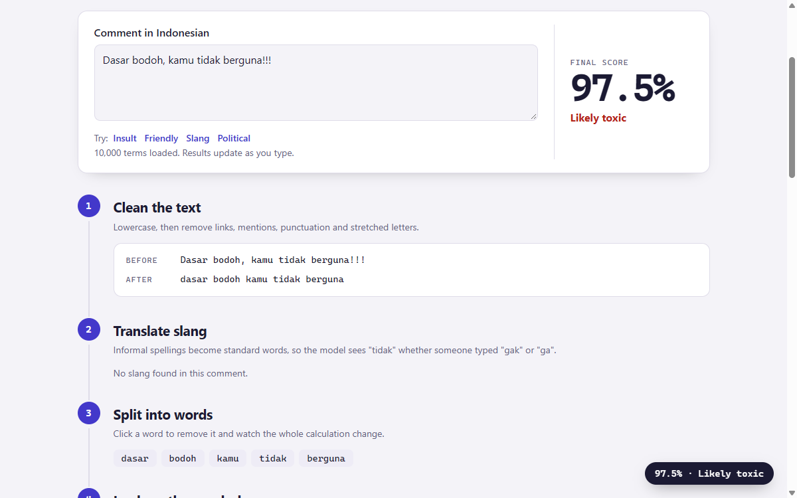

# Toxic Lens

Most toxicity checkers hand you a number. Toxic Lens shows how that number was made: paste an Indonesian comment and follow it through seven steps, from raw text to final score. Everything runs in your browser.

**[Try it live](https://adhigozalt.github.io/toxic-lens/)**



## The seven steps

1. **Clean** the text: lowercase, then remove links, mentions, punctuation and stretched letters.
2. **Translate slang** with a 14,531-entry dictionary.
3. **Split into words.** Click any word to remove it and watch every later number change.
4. **Look up the vocabulary** to see which words and two-word phrases the model knows.
5. **Weigh each term** with TF-IDF and multiply by its learned coefficient.
6. **See what pushed the score** in a diverging chart of each term's contribution.
7. **Compute the final score:** starting point + contributions = log-odds, then sigmoid = percentage.

The numbers on the page are the real calculation, not an after-the-fact approximation. Logistic regression is additive, so the contributions sum exactly to the result.

## Results

Measured on 1,924 unique tweets held back from training and tuning:

| Metric | Score |
|---|---|
| Accuracy | 88.9% (majority-class baseline: 55.6%) |
| Precision | 88.2% |
| Recall | 92.3% |
| F1 | 90.2% |
| ROC AUC | 0.956 |

Tweets are deduplicated after preprocessing and before splitting, so identical text cannot appear in both training and test data. Hyperparameters were chosen on a separate validation set.

## Limitations

- This is a simplified, explainable model, not the C-RNN from my [IEEE paper](https://jaelcorner.com/portfolio/#publication). It uses a different dataset, so the two accuracies are not comparable.
- The tweets are mostly political, so ordinary political language can score too high. Scores between 40% and 60% are labelled uncertain for this reason.
- It reads words, not intent. It should not be used to moderate or judge real people.

## Run it locally

```sh
npm start   # serves the app at http://localhost:4174
npm test    # includes a check that JavaScript matches the Python model
```

To retrain, download `re_dataset.csv` and `new_kamusalay.csv` from the dataset repository below into a folder, then run:

```sh
pip install -r training/requirements.txt
python training/train.py --data <that folder> --out .
```

## Data and licensing

Data and slang dictionary: Muhammad Okky Ibrohim and Indra Budi. 2019. [Multi-label Hate Speech and Abusive Language Detection in Indonesian Twitter](https://github.com/okkyibrohim/id-multi-label-hate-speech-and-abusive-language-detection). In *ALW3: 3rd Workshop on Abusive Language Online*, 46-57.

The code is MIT licensed. The files in `model/` derive from that dataset and are licensed under [CC BY-NC-SA 4.0](https://creativecommons.org/licenses/by-nc-sa/4.0/), which does not allow commercial use. The tweets themselves are not stored in this repository.
